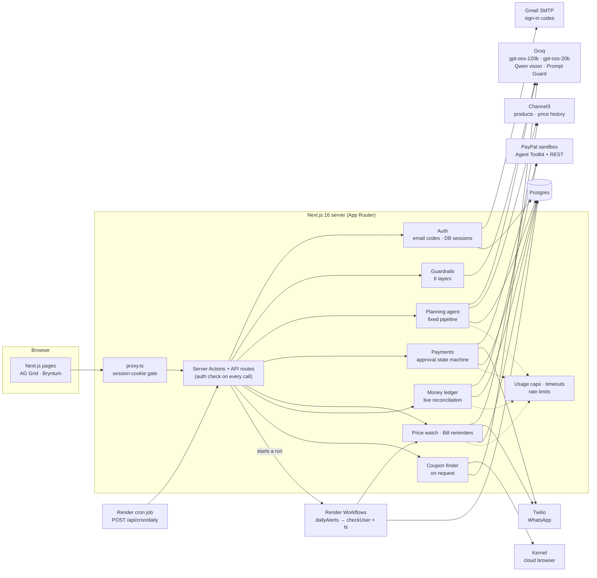

# LifeCart

**Tell LifeCart what's changing in your life. An AI agent plans the shopping from real store prices, you pay once with PayPal, and LifeCart watches prices and bills for you, messaging you on WhatsApp only when something needs you.**

Built for the PayPal AI Hackathon 2026. Everything runs against PayPal's **sandbox**, so no real money moves.

---

## Contents

1. [Features](#1-features)
2. [What's real today, and what's next](#2-whats-real-today-and-whats-next)
3. [How it works (user journey)](#3-how-it-works-user-journey)
4. [System architecture](#4-system-architecture)
5. [Agent design](#5-agent-design)
6. [Payment design](#6-payment-design)
7. [Security and guardrails](#7-security-and-guardrails)
8. [Data model](#8-data-model)
9. [Tech stack](#9-tech-stack)
10. [Run it locally](#10-run-it-locally)
11. [Testing and dev tools](#11-testing-and-dev-tools)
12. [Project structure](#12-project-structure)
13. [Roadmap](#13-roadmap)
14. [License](#14-license)

---

## 1. Features

### Accounts
- **Passwordless sign-in.** Enter your email and get a 6-digit code. Existing accounts go straight in; new accounts answer a few welcome questions (name, monthly shopping budget, where to ship, alert preferences).
- **Your own WhatsApp number, verified.**
  - **Joining:** an "Open WhatsApp" button sends the sandbox join message.
  - **Verifying:** LifeCart sends a 6-digit code to your number on WhatsApp, and you type it back. This proves the number is yours and that the join worked.
  - **Who gets alerts:** only verified numbers. A number that hasn't joined gets a clear "send the join message first" instead of a code that never arrives.
  - **Code rules:** codes are stored hashed, expire in 10 minutes, allow 5 tries, and are rate limited.
- **Profile and settings.** Everything you've shared in one place: monthly budget, "offer to pay in parts when I'm over budget", WhatsApp alert switches, connected accounts, sign out, and sign out on all devices.
- **Fresh start.** Every account starts empty, and you only ever see your own plans, bills and payments.
- **A monthly shopping budget that tracks spending.** You choose the amount and the day your budget month starts (1st to 28th, for example the day after payday).
  - **What counts as spent:** one-time purchases made this budget month, active monthly refills, and service invoices paid this month. Bills are tracked separately.
  - **Where it shows:** on the Profile page with a progress bar, on Home ("$310 left of your $500 shopping budget · starts fresh 1 December"), as the default budget for new plans, and in checkout's pay-in-parts hint.

### AI planning
- **Describe a life change or upload a photo:** "I'm out 9 to 7 and getting a golden retriever puppy", "moving into my first studio".
- **Or say it.** A mic button in the text box uses the browser's own speech-to-text (Web Speech API). It's hidden in browsers that don't support it; LifeCart only receives the text.
- **Asks before it plans.** Zero to three tap-to-answer follow-up questions, and none at all for specific requests.
- **A complete, budgeted plan.** Every item comes with a reason, is matched to a real store listing (Channel3) and checked against **90-day price history**. Independent stores are flagged when their prices are close.
- **Plan workspace.** An AG Grid table grouped by category, with a budget slider, an item drawer with alternatives and price history, and a **Watch / Buy now** button on every row.
- **Coupon finder (only when you press it).** "Find coupons" searches the web for current promo codes and deals for the stores in your plan:
  - A **Kernel** cloud browser searches for each store and reads coupon sites, with one tab per store, running in parallel.
  - The AI pulls out the offers. Each offer is linked to the page it came from and labelled "found on the web, not tested".
  - About 25–50 seconds, and results are reused for 12 hours.
- **Remove anything, with a confirmation.** Every unpaid plan item has a delete icon. The pop-up offers **Move to price watch** as the gentler option.

### Checkout with PayPal
- **One checkout, the right PayPal payment type for each item:**
  - **Orders** for one-time goods.
  - **Subscriptions** for monthly refills.
  - **Invoices** for local services (dog walker, vet visit, assembly).
- **Pay in parts.** If the total is over your monthly budget, checkout points you to PayPal Pay in 4 and shows the split.
- **Never charged twice.** Bought items are marked at capture, and a backstop also excludes anything an earlier checkout already captured.

### Price watch
- Move any product to **price watch** with a target price. LifeCart checks the live price at that store.
- **How targets are set:**
  - **By the agent:** "can wait" items start about 15–25% below the typical price, re-anchored to 15% below the real store price once it's known.
  - **When you press Watch:** the 90-day low if it's meaningfully below today's price, otherwise 15% off.
  - **When a check finds a wrong target** (price already at or under it without a real drop): reset to 15% below today's price instead of sending a false alert.
- **Change it anytime:** click the target in the plan table, the item drawer or Orders & watch. The editor shows today's price and the 90-day low, with quick picks (90-day low, 10% off, 20% off). A target must be below today's price and at least $1.
- An alert needs a **real drop** (lower than last seen *and* at or below your target). All drops in a run go out as **one** WhatsApp message, with a link back to the app to buy with PayPal. LifeCart never buys on its own.

### Bills
- Rent, utilities, internet, phone top-ups and subscriptions in one place, with a due-date timeline.
- **Your billing period, your way.** Pick the start and end of the current period (the end is the due date). LifeCart works out the length (1 month, 2 weeks, 3 months, a year...) and shows it as you pick. When you pay, the next period starts where this one ended, with the same length; whole months stay on the same day of the month.
- **Edit any bill** (pencil icon): change the amount, the period, the payee or the type.
- Pay one bill or "everything due this week" in a single PayPal payment.
- Insights: bills more than 15% above their average, and a cheaper phone plan that fits your usage (with yearly savings).
- **One** WhatsApp reminder for bills due within 3 days, at most once a day per bill.

### Money
- Lifetime **spent (after refunds)**, **saved**, **refunded** and **monthly recurring**, as stat tiles.
- Spend by type (plans, bills, price drops, refills, services).
- An **AG Grid ledger** of every payment, each one **re-checked live with PayPal** (refunds and amount mismatches are detected), with search and CSV export.
- A **Bryntum money calendar**: bills due, refill renewals, payments made and refunds.

### Orders and refills
- Live status of every refills subscription and service invoice from PayPal.
- Cancel refills from the app.

### Deleting things (always with an OK / Cancel pop-up)
| Where | What it does |
|---|---|
| Plan items | Removes the item; offers price watch instead. Items already paid for can't be deleted |
| Plans (plan page and Plans list) | Removes the plan, its items and price watches; expires its unpaid payment links. Blocked while the agent is still planning, or while its monthly refills are active (cancel them first, so PayPal stops charging) |
| Price watch (Orders & watch) | Stops watching by removing the item |
| Bills | Removes the bill and stops its reminders; expires unpaid payment links for it |
| Account (Profile) | Deletes the account and everything in it. Blocked while monthly refills are active |

Payments already made always stay on the Money page (until the account is deleted) and in PayPal.

---

## 2. What's real today, and what's next

| Real today (working end to end) | Not connected yet |
|---|---|
| The agent plans from **real product listings** and **real 90-day price history** (Channel3) | The order isn't placed with the retailer, so nothing ships |
| **Real PayPal sandbox payments**: orders captured, subscriptions approved and cancelled, invoices sent, refunds issued, each verified with PayPal | Payments go to **LifeCart's own sandbox merchant account**; they aren't passed on to the store or the biller |
| **Real WhatsApp messages** to each user's own verified number (Twilio sandbox) and **real email sign-in codes** | WhatsApp uses Twilio's free sandbox: each user sends a join message first, and it lapses after ~3 days without messages |
| Live reconciliation of every payment against PayPal | PayPal webhooks (status is checked live on page view instead) |
| The daily alerts job as **Render Workflows** tasks (one per user, with retries), tested end to end with Render's local task server, and deployable with [`render.paid.yaml`](render.paid.yaml) | The free live demo runs the same job inside the app, triggered daily by GitHub Actions; Render Workflows needs paid Render instances |

**In production, money would reach the store in one of three ways** (see [Roadmap](#13-roadmap)):
- **Agent-ready retailers:** stores that accept orders from AI agents (for example through PayPal's agentic commerce services) get the cart and the PayPal payment directly.
- **Independent stores:** they join as PayPal sellers, and one PayPal approval pays each store directly.
- **Everyone else, such as Amazon:** a hand-off link to the retailer's own checkout.

---

## 3. How it works (user journey)

```
Sign in with an email code
   │
   ▼
"What's changing in your life?"  ──►  guardrails screen the request
   │
   ▼
0–3 follow-up questions  ──►  plan built from real listings + price history
   │
   ├── Buy now items ──► Checkout ──► one PayPal approval
   │                                   ├─ Order captured (one-time goods)
   │                                   ├─ Subscription approved (refills)
   │                                   └─ Invoices emailed by PayPal (services)
   │
   └── Watch items ──► daily price check ──► real drop? ──► ONE WhatsApp ──► back to the app ──► PayPal
Bills ──► daily due-date check ──► due in 3 days? ──► ONE WhatsApp ──► back to the app ──► PayPal
Money ──► every payment re-checked live with PayPal
```

WhatsApp is **only for outreach** (price drops, bills due, renewals). Every message links back to the app, and paying always happens on PayPal.

---

## 4. System architecture



| Component | Responsibility | Code |
|---|---|---|
| **Proxy** | Optimistic redirect: app pages need a session cookie. Payment links stay public (they're single-use tokens) | `src/proxy.ts` |
| **Auth** | Email one-time codes, database sessions, `requireUser()` / `actionUser()` | `src/lib/auth/` |
| **Guardrails** | Screen every request before the agent sees it | `src/lib/guard/` |
| **Planning agent** | Questions, plan, offer matching, price history | `src/lib/agent/` |
| **Payments** | Orders, subscriptions, invoices, refunds through the PayPal Agent Toolkit; the approval state machine | `src/lib/paypal.ts`, `src/lib/approvals.ts` |
| **Price watch** | Live price per store, real-drop detection, one digest per run | `src/lib/watch.ts` |
| **Coupon finder** | On request only: web search per store in a Kernel browser, offer extraction, 12-hour cache | `src/lib/coupons.ts` |
| **Bills** | Bills hub, insights, due-date digest | `src/lib/bills.ts` |
| **Money** | Ledger reconciled live with PayPal, 5-minute per-user cache | `src/lib/money.ts` |
| **Daily job** | Price watch, then bill reminders, for every user. A daily schedule (a Render cron job, or GitHub Actions in the free deploy) calls `/api/cron/daily`. With Workflows configured, that starts a **Render Workflows** run: `dailyAlerts` fans out one `checkUser` task per user (batches of 10, each on its own compute, retried twice on failure). At most one start per hour. Without Workflows configured, the app runs the same code itself | `workflows/main.ts`, `src/lib/workflows.ts`, `src/lib/cron.ts`, `src/app/api/cron/daily` |
| **Usage** | Daily caps per provider, Groq rate-limit gate, timeouts | `src/lib/usage.ts`, `src/lib/ai.ts` |

**Rendering.** Pages use Cache Components: the static shell renders instantly, and anything that reads your session or data streams in behind `<Suspense>`. The AI never runs in the browser, and no API key reaches the client.

---

## 5. Agent design

The planner is a **fixed pipeline, not an open-ended loop**, so it can't run forever or burn through API quota.

| Step | What happens | Calls |
|---|---|---|
| 0 | Clarifying questions (0–3, tap-to-answer; skipped for specific requests) | 1 Groq |
| 1 | Photo description (cached on the plan) | ≤1 Groq vision |
| 2 | Draft the plan from your situation and answers (1–3 items for specific asks, 9–12 for life changes) | 1 Groq |
| 3 | Search store offers per product | N Channel3 |
| 4 | Match offers (same-kind check, price sanity band 0.33×–3×), one broader retry for unmatched items | 1–2 Groq, ≤N Channel3 |
| 5 | 90-day price history for the chosen offers | ≤N Channel3 |

**Models (Groq):**
- `openai/gpt-oss-120b`: planning, questions, offer matching.
- `qwen/qwen3.8-27b`: photos.
- `openai/gpt-oss-20b`: the scope and safety policy.
- `meta-llama/llama-prompt-guard-2-86m`: prompt-injection scoring.

**Reliability:**
- **Deadlines and timeouts.** Each run has a 3-minute deadline, and every external call has its own timeout (Groq 25–45 s, Channel3 12–18 s).
- **Single-flight.** A plan is claimed atomically (`draft → running`), so a second tab follows the first run instead of starting another.
- **Crash recovery.** A run stuck past its deadline is reclaimed.
- **Keeps going if you leave.** You can browse other pages while the agent plans; the run finishes in the background and the plan is ready when you come back. Coupon searches work the same way.
- **Degrades instead of failing.** Over the search budget, items get price estimates. Over the AI budget, planning pauses with a clear message.

---

## 6. Payment design

**The AI never moves money.** It has no payment tool at all. Every payment is server code calling the PayPal Agent Toolkit (and PayPal's REST API through the toolkit's client) after the user approves on PayPal.

| Need | PayPal API |
|---|---|
| One-time goods, bills, price-drop buys | **Orders v2** with `PAY_NOW`, captured server-side |
| Monthly refills | **Subscriptions** (product → plan → subscription) |
| Local services | **Invoicing v2** (create → send; PayPal emails the invoice) |
| Refunds | **Refunds** (create, then verify) |
| Reconciliation | **Capture details** and **subscription billing info** |

**The approval state machine.** Checkout freezes the amounts into a single-use approval and walks it through these steps:

```
order ─► capturing ─► subscription ─► confirming ─► invoices ─► invoicing ─► done
                                                                    └──► review (any mismatch)
```

- Each step is **claimed atomically**, so a double click or a page reload can't run it twice.
- The order is created with a **`PayPal-Request-Id` idempotency key**. Retries reuse an order that's already approved or completed instead of creating a new one.
- A capture only counts if PayPal reports **COMPLETED for the exact approved amount**. Anything else stops at `review`.
- Items are **marked as bought the moment the order is captured**, so abandoning a later step can't lead to a second charge.
- Approval tokens are random, **stored only as SHA-256 hashes**, and expire: 30 minutes for checkout, 6 hours for links in WhatsApp messages.
- Returning from PayPal is verified: the PayPal token or subscription id must match the one stored for that approval.

---

## 7. Security and guardrails

### Authentication and sessions
- **Passwordless email codes.** 6 digits from a cryptographic random source, stored as an **HMAC** (never in plain text). Each code is single use (claimed atomically), expires in **10 minutes**, allows **5 wrong tries**, and replaces any older code.
- **Rate limits.** 5 codes per email per hour, 15 per client per hour, 30 verification attempts per client per hour.
- **Database sessions.** The cookie holds a random 32-byte token, and only its SHA-256 is stored, so sessions can be revoked ("Sign out on all devices"). Cookies are `httpOnly`, `SameSite=Lax`, `Secure` in production, and last 30 days.

### Authorization and data isolation
- Every page, Server Action and API route checks the session **on the server**. The proxy redirect is only a convenience.
- **Every data function takes a `userId` and filters by it:** plans, items, offers, bills, approvals, refills, watch list and the money ledger. Changing a plan item first checks the item belongs to one of *your* plans.
- Opening another account's plan returns **not found**, not "forbidden", so ids can't be probed.
- The money page shows **only your own payments**. The merchant-wide PayPal transaction report is never shown to users.
- Tested by `scripts/isolation-test.mts`: 13 of 13 cross-account checks pass.

### AI guardrails (6 layers)
Every piece of user text (requests, answers, photo descriptions) and third-party text (store listings) is treated as untrusted.

| Layer | What it does | Code |
|---|---|---|
| 1. Hygiene | Strips control, zero-width and bidi characters; blocks fence markers; enforces length caps; clamps the budget; strictly checks photo data URLs; rate limits (12 new plans per hour per user) | `guard/sanitize.ts`, `guard/ratelimit.ts` |
| 2. Injection classifier | **Llama Prompt Guard 2**: a score of 0.85 or more is blocked | `guard/check.ts` |
| 3. Scope and safety policy | **gpt-oss-20b** applies a written policy: allow / out of scope / prohibited / manipulation, with a self-harm response that gives the 988 crisis line. **Fails closed.** "Write me a bedtime story" is politely declined | `guard/policy.ts` |
| 4. Prompt fencing | Untrusted text goes inside randomly tagged data blocks, and the system prompts say never to follow instructions inside them | `agent/planner.ts` |
| 5. Output checks | Zod schemas bound item counts and prices; a prohibited-item filter catches anything that slips through; the model never produces URLs or payment actions. Coupon pages from the web are fenced the same way; a code is kept only if it appears verbatim on its source page, and source links come from our own list, never the model | `agent/schemas.ts`, `agent/run.ts` |
| 6. Architecture | The AI has **no tool that moves money**; payments need the user's approval on PayPal | `lib/approvals.ts` |

Tested by `scripts/guard-test.mts` (15 of 15 passing, run as signed-in users).

### Payments
- Amounts are **frozen on the server** when you start checkout; the browser never sends a price.
- Idempotency keys, atomic step claims, exact-amount verification and the double-charge backstop are described in [Payment design](#6-payment-design).

### Messaging (no spam)
- At most **one** price-drop message and **one** bill message per user per run, with at most 3 items in a price-drop message.
- Per-item cooldowns: 24 hours for price alerts and for bill reminders.
- The daily job is single-flight and runs **at most once an hour**, even if a scheduler misfires.
- Users can turn each kind of alert off in their profile.

### Scheduled endpoint
- `POST /api/cron/daily` requires `Authorization: Bearer $APPROVAL_SECRET`, compared in **constant time**.

### API budgets and abuse limits
- **Daily caps** per provider, stored in the database and shown on `/setup`:

  | Provider | Daily cap |
  |---|---|
  | Groq | 800 requests |
  | Channel3 | 2,500 credits |
  | Twilio | 100 messages |
  | PayPal | 2,000 calls |
  | Kernel | 60 sessions |

- A Groq **rate-limit gate** reads the `x-ratelimit-*` headers and waits rather than hitting 429 errors.
- Live PayPal lookups are capped per page view (8 on Orders, 30 on Money) and cached for 5 minutes on Money.
- Per-user rate limits on payments, price checks, refreshes, bill changes and coupon searches (5 per hour, one Kernel session each).

### Secrets
- All keys live in `.env.local` (gitignored) or the host's environment. Nothing secret is sent to the browser.
- PayPal credentials stay on the server. Users log in to PayPal themselves, and LifeCart never sees their PayPal password or card.

---

## 8. Data model

| Table | Holds |
|---|---|
| `users` | email (verified), name, monthly budget and the day it resets, ship-to, preferences (pay in parts, alerts, demo tools), WhatsApp number with its verification state, onboarding time |
| `auth_codes` | hashed one-time codes, expiry, attempts |
| `sessions` | hashed session tokens, expiry |
| `goals` | a plan: prompt, photo note, questions and answers, title, summary, status (`draft / running / ready / blocked`), agent steps |
| `plan_items` | item, reason, category, kind (product or service), cadence, quantity, payment type (order / subscription / invoice / watch), target price, purchased at |
| `offers` | store listings per item: merchant, price, was-price, availability, 90-day stats, rank, independent-store flag |
| `price_snapshots` | live prices seen by price watch |
| `bills` | payee, amount, average, due date, autopay mode, plan options, last reminded, paid at |
| `approvals` | a frozen payment: kind (cart / bill / watch), lines, totals, hashed token, current step, PayPal ids, result |
| `payments` | per-type PayPal records (subscription and invoice ids, status) |
| `coupons` | offers found on the web per store domain (title, discount, code if shown in full, source link), reused for 12 hours |
| `api_usage` | calls and units per provider per day, plus the provider's own reported limits |

Drizzle ORM on **Postgres** (`DATABASE_URL`), both locally and on Render. If `DATABASE_URL` is blank, the app falls back to an embedded PGlite database in `./.data`.

---

## 9. Tech stack

(sponsor tools: PayPal Agent Toolkit, Render + Render Workflows, AG Grid, Channel3, Kernel, Bryntum)

| Area | Choice |
|---|---|
| App | **Next.js 16** (App Router, Server Actions, Cache Components, Turbopack), TypeScript, React 19 |
| UI | Tailwind CSS v4, shadcn/ui, lucide icons |
| Data grid | **AG Grid Community**: the plan table and the money ledger |
| Calendar | **Bryntum Calendar** (trial): the money calendar, loaded at runtime from `public/vendor` |
| Database | **Postgres** with Drizzle ORM (locally Homebrew Postgres 18, started by `npm run dev:all`; an embedded PGlite fallback if `DATABASE_URL` is blank) |
| AI | Vercel AI SDK with **Groq** (gpt-oss-120b, gpt-oss-20b, Qwen vision, Llama Prompt Guard 2) |
| Payments | **PayPal Agent Toolkit** + PayPal REST (sandbox): Orders, Subscriptions, Invoicing, Refunds |
| Products | **Channel3**: product search, offers, 90-day price history, live prices |
| Coupons | **Kernel** cloud browser (Playwright) for web search and coupon pages |
| Background jobs | **Render Workflows** (`@renderinc/sdk`): the daily alerts job fans out one task per user, with retries |
| Messaging | **Twilio** WhatsApp sandbox (per-user verified numbers); Gmail SMTP for sign-in codes |
| Hosting | **Render**: the live demo runs on a free web service with Neon Postgres and a GitHub Actions schedule. The full Blueprint adds Render Postgres, Workflows and a cron job |

---

## 10. Run it locally

```bash
npm install
cp .env.example .env.local   # paste your keys; every variable has a comment saying where to get it
createdb lifecart            # once; then set DATABASE_URL=postgresql://<you>@localhost:5432/lifecart
npm run dev:all              # starts Postgres + the app at http://localhost:3000; Ctrl+C stops both
npm run db:push              # in a second terminal, once: creates the tables
```

`npm run dev:all` expects Homebrew Postgres 18 (`brew install postgresql@18`). Without Postgres, leave `DATABASE_URL` blank and use `npm run dev`: the app creates an embedded database in `./.data`.

- **Sign in without email set up:** if `GMAIL_USER` / `GMAIL_APP_PASSWORD` are empty, the sign-in code is printed in the `npm run dev` terminal (development only).
- **Integration status and API usage:** open `/setup` while signed in.
- **Demo tools** (sample bills, "send reminder now", "simulate a price drop"): turn them on in **Profile → Demo tools**.
- **Open WhatsApp links on your phone:** `npm run tunnel` prints a public HTTPS URL. Put it in `APP_URL`.

**Environment variables** (see `.env.example`):
- `APP_URL`, `APPROVAL_SECRET`
- `GROQ_API_KEY`
- `PAYPAL_CLIENT_ID`, `PAYPAL_CLIENT_SECRET`, `NEXT_PUBLIC_PAYPAL_CLIENT_ID`
- `CHANNEL3_API_KEY`
- `TWILIO_ACCOUNT_SID`, `TWILIO_AUTH_TOKEN`, `TWILIO_FROM`, `TWILIO_SANDBOX_JOIN` (e.g. "join drop-particles")
- `GMAIL_USER`, `GMAIL_APP_PASSWORD`
- `DATABASE_URL` (local or Render Postgres; blank means the embedded PGlite fallback)
- `RENDER_API_KEY`, `RENDER_WORKFLOW_SLUG` (Render Workflows for the daily job; blank means the app runs it itself), `RENDER_USE_LOCAL_DEV` (local testing only)

| Script | What it does |
|---|---|
| `npm run dev:all` | **Everything in one command:** starts local Postgres (Homebrew postgresql@18) and the app; **Ctrl+C** stops the app and shuts Postgres down cleanly |
| `npm run dev` | Dev server only (first copies Bryntum's files into `public/vendor`) |
| `npm run build` / `start` | Production build and server |
| `npm run db:push` | Sync the schema to the database |
| `npm run db:studio` | Browse the database |
| `npm run workflows` | Start command for the Render Workflows service (`tsx workflows/main.ts`) |
| `npm run workflows:dev` | Run the workflow locally with Render's task server (`render workflows dev`, Render CLI 2.35+) |
| `npm run tunnel` | Public HTTPS tunnel to localhost:3000 |
| `npm run lint` / `typecheck` | Lint and type-check |

**Deploy to Render.** There are two Blueprints. Render Dashboard → New → Blueprint → this repo → choose the Blueprint path, then paste each prompted secret from your `.env.local`.

| | Free: [`render.yaml`](render.yaml) (the live demo) | Full: [`render.paid.yaml`](render.paid.yaml) |
|---|---|---|
| Card at Render | Not needed | Needed (paid instances) |
| App | `lifecart` on a free instance. It sleeps after ~15 min idle and takes about a minute to wake | `lifecart` on Starter, always on |
| Database | [Neon](https://neon.tech) free Postgres: paste its pooled connection string into `DATABASE_URL` | `lifecart-db`, Render Postgres 18 |
| Schema | `npm run db:push` during each build | `npm run db:push` as the pre-deploy step |
| Daily alerts | [GitHub Actions](.github/workflows/daily-alerts.yml) calls `POST /api/cron/daily` at 15:00 UTC; the app runs the job itself | Render cron job → **Render Workflows** run (`lifecart-workflows`): one `checkUser` task per user, with retries |

Both: Node 24 (`.node-version`), `npm run start`, and the public URL comes from Render's `RENDER_EXTERNAL_URL`, so `APP_URL` can stay unset. `APPROVAL_SECRET` is generated by Render.

- **Free setup, daily alerts:** in GitHub → Settings → Secrets and variables → Actions, add `LIFECART_URL` (the app's URL) and `LIFECART_CRON_SECRET` (the `APPROVAL_SECRET` value from the Render service's Environment tab). The job only reports counts, so its public log contains no user data.
- **Full setup:** `RENDER_WORKFLOW_SLUG` is filled in from the workflow service. Add `RENDER_API_KEY` (Account Settings → API Keys) to start the daily job as a workflow run; without it the app runs the same job itself.

---|---|
| `lifecart-db` | Postgres 18. The schema is applied by `npm run db:push` before every deploy |
| `lifecart` | The Next.js app (Node 24, `npm ci && npm run build`, `npm run start`). Its public URL comes from Render's `RENDER_EXTERNAL_URL`, so `APP_URL` can stay unset |
| `lifecart-workflows` | The Render Workflows task server (`npm run workflows`). It copies its keys from the web service |
| `lifecart-daily` | Cron job, daily at 15:00 UTC: `POST /api/cron/daily` over Render's private network, with `APPROVAL_SECRET` as the bearer token |

`APPROVAL_SECRET` is generated by Render, and `RENDER_WORKFLOW_SLUG` is filled in from the workflow service. Add `RENDER_API_KEY` (Account Settings → API Keys) to start the daily job as a workflow run; without it the app runs the same job itself.

---

## 11. Testing and dev tools

All in `scripts/`, run with `npx tsx --env-file=.env.local scripts/<name>`. There are two kinds:
- **Browser tests** need the dev server running. They sign in throwaway `@example.com` accounts through the real sign-in page. Addresses on reserved test domains are never emailed; in development their code is printed in the dev server log, so these scripts take that log file as an argument.
- **Database scripts** need Postgres running (`npm run dev:all` in another terminal). With the PGlite fallback, stop the app first instead, because PGlite allows one process at a time.

| Script | What it checks |
|---|---|
| `guard-test.mts <devLog>` | Guardrails: 12 allowed and blocked requests, an injected answer, a normal answer, and the per-user rate limit (15 of 15 passing) |
| `auth-test.mts <devLog> <outDir>` | Sign up, wrong code, welcome questions, profile, empty fresh pages, a second account, sign out, returning user |
| `isolation-test.mts` | 13 cross-account checks: nobody can read or change another account's data (database script) |
| `e2e-paypal.mts <planId> <outDir> --email … --log <devLog>` | Full PayPal sandbox checkout in a real browser: order, subscription, invoices, receipt, optional cancel |
| `mail-check.mts` | Gmail SMTP login (sends nothing) |
| `wipe-data.mts` | Fresh start: deletes all user data (dry run by default) |
| `delete-plan.mts` | Deletes one plan but keeps its payment records |
| `refund-duplicates.mts` | Finds and refunds duplicate sandbox captures (dry run by default) |
| `features-test.mts <devLog> <outDir>` | Builds a real plan, runs Find coupons, then every delete flow (item, move to watch, stop watching, bill, plan, account) |
| `coupon-test.mts <devLog> <outDir>` | Presses Find coupons on a reusable test plan and prints what was found |
| `coupon-probe.mts <domain>` | One Kernel session: raw web search + coupon pages for a store |
| `clear-coupon-cache.mts` | Forgets cached coupon searches (database script) |
| `workflow-test.mts` | Triggers `dailyAlerts` like the cron route does (needs `npm run workflows:dev`); checks it finishes, fans out per user, and isn't started twice in an hour |
| `navigate-away-test.mts <devLog>` | Other pages load while the agent plans; the plan finishes after you leave; coupon results are saved after you leave |
| `whatsapp-verify-test.mts <devLog> <outDir>` | WhatsApp setup: unjoined number refused, wrong code, real code verified, number removed |
| `bill-period-test.mts` | Billing periods: lengths (month, weeks, quarter, year), rolling forward after payment, bad dates refused (14 of 14) |
| `bills-edit-test.mts <devLog> <outDir>` | Add a bill with a 2-week period, bad dates flagged, edit amount and period, mic button shown or hidden by browser support (9 of 9) |
| `budget-test.mts` | Budget month dates (including year boundaries) and the spent / left maths |
| `target-test.mts <devLog> <outDir> <planPath>` | Editing a watch target: too high refused, quick pick saved, edit on Orders & watch |
| `copy-pglite-to-postgres.mts` | One-off: copy everything from the embedded database into Postgres |
| `dev-all.sh` | Behind `npm run dev:all`: Postgres + app, clean shutdown on Ctrl+C |
| `dev-watchdog.sh`, `mem-guard.sh` | Run the dev server with a memory cap |
| `page-shot.mts`, `signed-in-shot.mts`, `file-shot.mts` | Screenshots at desktop and phone width |

---

## 12. Project structure

```
src/
  app/                    pages, Server Actions, API routes
    page.tsx              sign-in landing (signed out) / home (signed in)
    welcome/  profile/    onboarding questions, profile and settings
    plans/[id]/           plan workspace and checkout
    approve/[token]/      single-use payment link → PayPal → receipt
    bills/  orders/  money/
    api/cron/daily/       scheduled price watch + bill reminders
    actions.ts            app actions (all check the signed-in user)
    auth-actions.ts       sign-in, sign-out, profile
  components/             UI (plan grid, checkout, money ledger and calendar, auth)
  lib/
    agent/                planning pipeline, prompts, schemas
    guard/                guardrail layers
    auth/                 codes, sessions, email
    paypal.ts             every PayPal call (the AI never calls these)
    approvals.ts          approval state machine
    watch.ts  bills.ts  money.ts  cron.ts  usage.ts
  db/schema.ts            tables
  proxy.ts                session-cookie redirect
workflows/main.ts         Render Workflows tasks: dailyAlerts → checkUser (one per user)
scripts/                  test and dev tools
```

---

## 13. Roadmap

1. **Pay the store, not LifeCart.** Use agent checkout with retailers that support it (PayPal agentic commerce, agent-ready Shopify stores), PayPal multiparty payments so one approval pays each independent store, and a hand-off link for retailers like Amazon.
2. **Pay the biller.** Forward bill payments with PayPal Payouts to the biller's PayPal account, or through a bill-pay network.
3. **A registered WhatsApp Business sender** (Twilio + Meta Business) with approved message templates, so anyone can get alerts without the sandbox join step.
4. **PayPal webhooks** for capture, refund and subscription events, instead of checking live on page view.
5. **Rules for small refills**, such as "auto-approve refills under $40", within limits you set.
6. **Test and apply coupon codes automatically** when the order is placed with the store (most coupon sites hide full codes behind a click, so today LifeCart links to them).

---

## 14. License

MIT. See [LICENSE](LICENSE).
